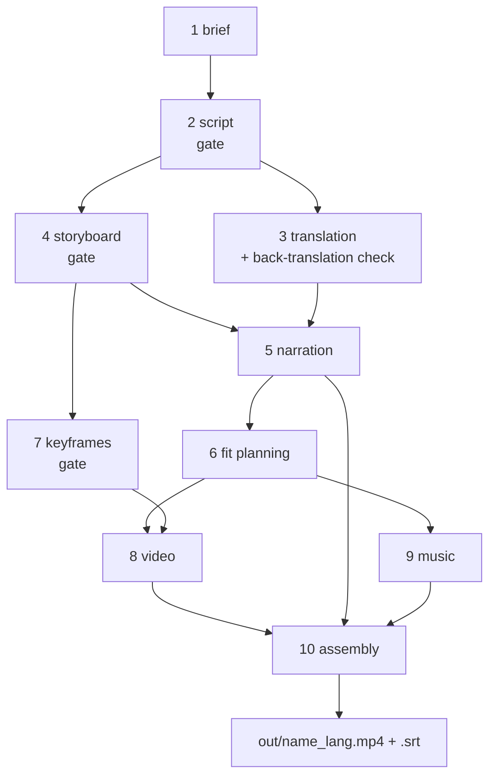

# Architecture

`vidpipe` turns a written brief into a narrated, scored, subtitled video in one or
more languages. It is a Python 3.12 library with a command line on top and an
optional local web UI. Words used here are defined in [GLOSSARY.md](GLOSSARY.md).

## The shape



The runner executes the ten stages in the order of their numbers. The arrows show the
main data flow. "gate" marks where a run pauses for approval by default.

```
vidpipe run / redo / approve / stop / plan / doctor / ui          (cli.py)
        |
   pipeline.py  -- one-writer lock, plan, gates, run state, stop
        |
   stages.py    -- ten stages, each asks the ledger before generating
        |                    |
   artifacts.py         registry.py + chain.py
   build/ledger.json         |
                        typed provider contracts (contracts.py)
                             |
     +-----------+-----------+------------+--------------+
     Text CLIs   Edge TTS /   ComfyUI HTTP               FFmpeg
     (Claude,    Addis AI     (FLUX.2, Wan 2.2,          (assembly.py)
     Codex,                    ACE-Step workflows)
     Gemini)
```

## A project on disk

```
<project>/
  brief.md            what the film is
  vidpipe.yaml        project config: languages, providers, size, gates, mix
  bible.yaml          optional: style, characters, locations
  storyboard.json     optional editable contract (vidpipe export-storyboard)
  runs.jsonl          one line per model call
  build/              every intermediate artifact, ledger, run state, lock, logs
  out/                <output_name>_<lang>.mp4 and .srt
```


There is no database. The folder is the state.

## The storyboard contract

`<project>/storyboard.json` is the editable contract: one file that says what is said,
what is seen and what is heard. `vidpipe export-storyboard <project>` writes it from a
build that has reached the storyboard stage, and never overwrites an existing one.

| Field | Meaning |
|---|---|
| `title` | the film's title |
| `shots[].id` | positive, unique shot number; also the shot's default seed. List order is edit order |
| `shots[].reason` | one sentence saying why the shot exists |
| `shots[].narration` | the spoken line, keyed by language |
| `shots[].visual` | the keyframe prompt: framing, subject, setting, light, mood |
| `shots[].motion_type` | `push_in`, `pan` or `ambient`, and nothing else |
| `shots[].character`, `location` | ids from the project bible; no `character` means the protagonist, `"none"` means nobody |
| `music` | `prompt`, optional `bpm`, `keyscale` and per-shot `cues` |

When the file exists, every run validates it first (unknown fields, duplicate ids,
missing languages and unknown bible ids are errors), and the script, translation and
storyboard stages take their content from it instead of calling a text model. The
back-translation check therefore does not run on a contract: check drift before
exporting, and after editing a translated line. Without the file, those stages write
`build/script.json`, `build/translation/` and `build/storyboard.json` themselves.

`vidpipe schema` writes the JSON Schemas of the storyboard and of `vidpipe.yaml` into
`schema/`.
Every file between stages is a Pydantic model (`models.py`), so a stage rejects
malformed input when it reads it, and a text model's reply is validated before it is
saved.

## Stages and their contracts

| # | Stage | Provider contract (request to result) | Reads | Writes (under `build/`) | Artifact keys |
|---|---|---|---|---|---|
| 1 | brief | none | `brief.md` | `brief.json` (`Brief`) | `brief` |
| 2 | script | `TextProvider.complete(TextRequest) -> TextResponse`, validated as `ScriptDraft` | brief | `script.json` (`Script`) | `script` |
| 3 | translation | `TranslationProvider.translate(TranslationRequest) -> TranslationResponse` | script | `translation/<lang>.json`, `.review.json` | `translation/<lang>`, `.../review` |
| 4 | storyboard | `TextProvider`, validated as `StoryboardDraft` | script, bible | `storyboard.json` (`Storyboard`) | `storyboard` |
| 5 | narration | `TTSProvider.synthesize(TTSRequest) -> TTSResult(path, duration_s)` | storyboard, scripts | audio files, `narration.json` | `narration/<lang>/shot_NN` |
| 6 | fit planning | none (pure function) | narration, storyboard | `fit_plan.json` (`FitPlan`) | `fit_plan` |
| 7 | keyframes | `KeyframerProvider.generate(KeyframeRequest) -> KeyframeResult` | storyboard, bible | `keyframes/shot_NN.png`, `keyframes.json` | `keyframes/shot_NN` |
| 8 | video | `ImageToVideoProvider.animate(ImageToVideoRequest) -> ImageToVideoResult` | fit plan, keyframes | clips, `video.json` | `video/shot_NN[_clip_MM]` |
| 9 | music | `MusicProvider.compose(MusicRequest) -> MusicResult` | brief, fit plan | audio, `music.json` | `music` |
| 10 | assembly | `Assembler.assemble(AssemblyJob)` | all media | `out/*.mp4`, `out/*.srt` | `assembly/<lang>` |

A `SongProvider` contract (lyrics and vocals) also exists, with a fake only. It is not
part of the stage graph.

**Music candidates.** `music.candidates` asks for several scores with different seeds
(`build/music/candidate_N`), and `music.choice` (counted from 1) picks the one that
assembly uses. Changing only the choice reuses every candidate and re-runs assembly.
Write the reason for the choice in `DESIGN.md`.

## Providers: registry and plug-ins

Every contract is an abstract class in `contracts.py`. A provider:

- has a `kind` and a unique `name`;
- declares typed `capabilities`, checked at plan time, before anything is generated;
- takes a request model with an `extras` dictionary for provider-specific options;
- declares a `cost = CostModel(...)` used by `vidpipe plan`;
- returns a `fingerprint()`, which is hashed into everything it makes;
- may use `attach` (project context), `release` (free GPU memory) and
  `unhashed_options` (a server address or timeout must not regenerate anything);
- raises `UnsupportedRequest` or `GenerationError`.

Providers register with `@register`, or from another package through the
`vidpipe.providers` entry point. `vidpipe.yaml` picks one per stage:

```yaml
providers:
  script: [claude-cli, codex-cli]        # a fallback chain
  narration: edge-tts
  video: {name: comfyui-i2v, options: {settings: {width: 640, height: 352}}}
```

Registered today: text `claude-cli`, `codex-cli`, `gemini-cli`; narration `edge-tts`,
`addis-ai`; `comfyui-keyframer`, `comfyui-i2v`, `comfyui-music`; and a fake for every
contract.

**A new ComfyUI model needs no Python.** It is a workflow exported in API format plus
a mapping file that says which node inputs receive the prompt, seed, size and images,
what the limits and cost are, and how to step down after running out of memory
([format](workflows/README.md#mapping-files)).

**Proof that providers are swappable:** one conformance suite per contract runs
against every registered provider; fakes in CI, real ones under
`pytest -m integration`. In real use, changing only the storyboard provider in YAML
regenerated only the storyboard ([experiment 11](EXPERIMENTS.md)).

## Caching and the ledger

Every generated artifact goes through `StageContext.produce` into
`ArtifactStore.produce` (`artifacts.py`). The stage declares what the artifact
depends on, and the store hashes:

```
input_hash = sha256( ledger version,
                     stage,
                     provider.fingerprint(),      # for ComfyUI: workflow digest + settings
                     provider options from YAML   # minus unhashed ones
                     content hashes of input files,
                     digests of input values,     # prompt, text, sizes, durations
                     parameters,
                     seed )
```

If `build/ledger.json` holds a record with that hash and its output files exist, the
generator is not called. Otherwise it runs, and the record is saved atomically before
the next artifact starts.

A record keeps: key, input hash, each input's hash, provider and options, parameters,
seed, GPU seconds, wall seconds, start time, output paths with SHA-256 and size,
small result data (durations, attempts, prompt) and any `fallback` applied.

Consequences:

- The same command resumes a killed run. At most the artifact in flight is lost.
- Inputs are hashed by content, so an upstream file regenerated identically
  invalidates nothing.
- Hand edits to `build/` files are kept; only artifacts that read them are redone.
- `vidpipe plan` and the UI estimate what the next run will redo by probing the same
  code with generation refused (`regeneration.py`).

**Known gap.** Output hashes are recorded but, for media, not re-checked on reuse, so
a corrupted file of the same name would be reused ([failure 31](FAILURES.md)). Files
written from `storyboard.json` are checked, so the contract always wins over an edit in
`build/`.
## The call log

The ledger keeps only the latest record per artifact. `<project>/runs.jsonl` is the
append-only history: one JSON line per generation attempt, including failures,
re-prompts, fallbacks and ComfyUI retries. Reused artifacts add no line.

| Field | Meaning |
|---|---|
| `ts`, `run_id` | start of the call (UTC) and the run it belongs to |
| `stage`, `artifact` | stage and ledger key |
| `provider`, `model` | provider, and model, workflow or voice when known |
| `parameters`, `seed` | settings and the attempt's seed; options that look like secrets or URLs are left out |
| `latency_s`, `gpu_seconds` | wall time, and GPU time when the backend reports it |
| `cost_usd`, `list_price_usd` | charge (0 for local and subscription calls) and a declared list price |
| `outcome`, `error` | `ok` or `error`, with the error type |


Token counts are not recorded.

### What one edit regenerates

| You change | Regenerated |
|---|---|
| one shot's `visual` | that keyframe, its clip(s), assembly |
| one shot's `motion_type` | its clip(s), assembly |
| one shot's narration in `storyboard.json` | that narration, the fit plan, assembly; the clip if its planned length changes |
| one line in `build/translation/` (no contract) | the same, plus the back-translation check |
| a voice or narration provider | all narration, fit plan, any clip whose length changes, assembly |
| mix, subtitles, `output_size`, end card text | assembly (an end card also changes the music length) |
| one line of `build/script.json` (no contract) | translation, storyboard and everything that follows from what changed in them |
| `music.choice` | assembly only |

The music is regenerated when the longest render (plus end card) crosses a whole
second.

## Gates

A run pauses after `script`, `storyboard` and `keyframes` (configurable; `gates: []`
for none). A pause exits with code 3. Approve with `vidpipe approve`, `--approve`, the
terminal prompt or the UI; `--auto` skips every gate. An approval is a digest of the
gated stage's output files, so a hand edit, a redraw or a redo asks again.

## Redo one shot

`vidpipe redo shot N <project>` raises the shot's re-roll count in the ledger. That
changes the seed of its keyframe and video, so their input hashes change, and the new
clip changes what assembly reads. Everything else is reused. Gates still apply.

Re-roll counts live in the ledger, not in `storyboard.json`. A clean clone starts every
shot at its default seed. The Lion's Whisker used no `redo` (its fixes were prompt
edits), so its seeds are the defaults.

## The fit planner

Narration is generated first, and its real length decides the video (`fit.py`,
`segmentation.py`).

1. One clip, played between 1/1.3x and 1.3x so the shot lasts exactly as long as its
   narration. Narration is never time-stretched.
2. If that is not enough, the line is cut at sentence ends, then clause marks
   (including Ethiopic `። ፣ ፤`), then between words. Each further segment is a
   *continuation clip* that starts from the previous clip's last frame.
3. `visuals: shared` (default) sizes one clip set per shot to the longer language;
   `per_language` and `primary_only` are the alternatives.
4. Every render, end card included, must stay within 90 s. If it cannot, the run
   fails and names the language.

## Failure handling

| Failure | Handling | Where |
|---|---|---|
| ComfyUI job error, timeout, lost job, no output | up to 2 retries, each with a new deterministic seed | `comfy/jobs.py` |
| Out of GPU memory | free memory, apply the mapping's step-down **once** (smaller reference, size or decode tile), new seed; a second failure fails the stage. Verified against a fake server only | mapping files |
| Workflow rejected, server unreachable, job cancelled in ComfyUI | fail at once; a new seed would not help | `comfy/jobs.py` |
| Invalid text reply | re-prompt with the validation error, up to 2 times | `providers/cli_text.py` |
| Text provider failure, rate limit, quota | next provider in the chain; recorded as `fallback` | `text.py` |
| Translation checker | never the translator if the chain has another; failure keeps the translation and resumes at the check | `translate.py` |
| Meaning drift | flagged and printed, never blocks | `translate.py` |
| Edge TTS network error | 3 attempts | `providers/edge.py` |
| Bad config, unsupported size, missing font or ffmpeg filter | refused at plan time, before generation | `pipeline.py` |
| Run killed | rerun the same command; finished artifacts are reused | ledger |
| Two writers | the second exits and names the first | `lock.py` |
| Stop request | ends after the current artifact; `--now` also cancels the ComfyUI job | `stop.py` |

No other silent quality change is made. A step-down is always recorded.

**One-writer lock.** `run`, `redo` and `approve` hold an OS file lock on
`build/run.lock`. The OS releases it when the process dies, so a crash never blocks
the next run. Network drives are unsupported.

**Stop requests.** `vidpipe stop` does not take the lock. It writes
`build/stop_request.json` naming the run; the run polls every 0.1 s, acts between
artifacts and exits with code 4.

**Run state.** The runner atomically rewrites `build/run_state.json` (status, current
stage, per-stage counts, error, config hash). A `running` record whose process is gone
reads as `failed`. Config edits made during a run apply to the next one
([ADR 0002](docs/adr/0002-config-changes-apply-next-run.md)). Full field list in the
[README](README.md#run-state).

**GPU use.** Jobs run one at a time, and each ComfyUI model is unloaded after its
stage.

**Exit codes:** 0 finished, 1 error, 3 paused at a gate, 4 stopped.

## Assembly

FFmpeg does everything in one filter graph per language (`assembly.py`):

1. each clip is trimmed, retimed to its planned speed, set to the frame rate, scaled
   to cover the output frame and cropped (`output_size` gives exact 16:9 or 9:16);
2. a shot's clips are joined and fixed to the narration length;
3. narration is concatenated; the music sits at `mix.music_level` (0.4) and a
   sidechain compressor keyed on the voice ducks it (ratio 8, attack 20 ms, release
   400 ms), followed by a limiter;
4. subtitles are burned in with libass (Noto Sans Ethiopic for Amharic); the sidecar
   SRT is always written;
5. the optional end card is drawn on black and the music fades out under it;
6. H.264 (yuv420p) and AAC in MP4, `faststart`.

**Subtitle language.** `subtitles.text_language: en` puts English subtitles on the
Amharic render. The translation stage then also covers that language if needed. Lines
are wrapped to at most two per cue (about 42 columns), long lines are split over time,
the size follows the shorter side of the frame, and portrait renders leave more room
below.
**Loudness.** The final mix is measured and then normalised in a second pass with
`loudnorm` to `mix.loudness_lufs` (default -14 LUFS, true peak -1 dBTP).

**Provenance.** Each MP4 carries the title and a comment saying it is AI-generated.

**Radio cut.** `vidpipe radio-cut <project>` renders the narration and subtitles over
black, as `out/<name>_<lang>_radio.mp4`, for the first user test. It uses the score if
one exists and a quiet placeholder tone otherwise. It needs narration and a fit plan,
and no GPU.
## The UI

`vidpipe ui <project>` serves one project (optional `ui` extra: Starlette, uvicorn,
ruamel.yaml). The front end is plain HTML, CSS and JavaScript with no build step.

- **Run view:** the ten stages as a rail with live status over one server-sent event
  stream; each stage's keyframes, clips, narration and translation review; start,
  stop, stop now, resume, redo a shot, approve or reject a gate.
- **Config view:** a form from the config schema, provider choices filtered by
  contract with readiness from `doctor`, a YAML preview, and what a change will
  regenerate. Saving keeps comments and key order.
- **Runs** started by the UI are separate processes running the normal CLI, so they
  survive the tab and the server closing.
- **Access:** loopback only by default; any other `--host` requires a token.

The UI never generates anything itself. It reads the same files and runs the same
commands as the terminal.

## Testing

Two seams, no tests of internals:

1. **The pipeline** through the CLI or library on fake providers: caching, resume,
   gates, redo, plan, failures, and the final render checked with ffprobe.
2. **Provider conformance**, one suite per contract.

The UI is tested through its HTTP API, with an opt-in Playwright suite for the
browser. ComfyUI behaviour is tested against an in-process fake server.

## Limits and open design gaps

- One narration provider covers every language, so `doctor` can miss a dependency.
- A partial run still checks providers for stages it will not run.
- The storyboard model sees character names but not descriptions; a keyframe gets only
  its main character's description.
- Image and video quality problems are not detected automatically. The keyframe gate
  and redo are the defence.
- `vidpipe` does not install or manage ComfyUI.
- Text stages are not deterministic. Reproducing a film needs its `storyboard.json`
  and bible, not only its brief.
