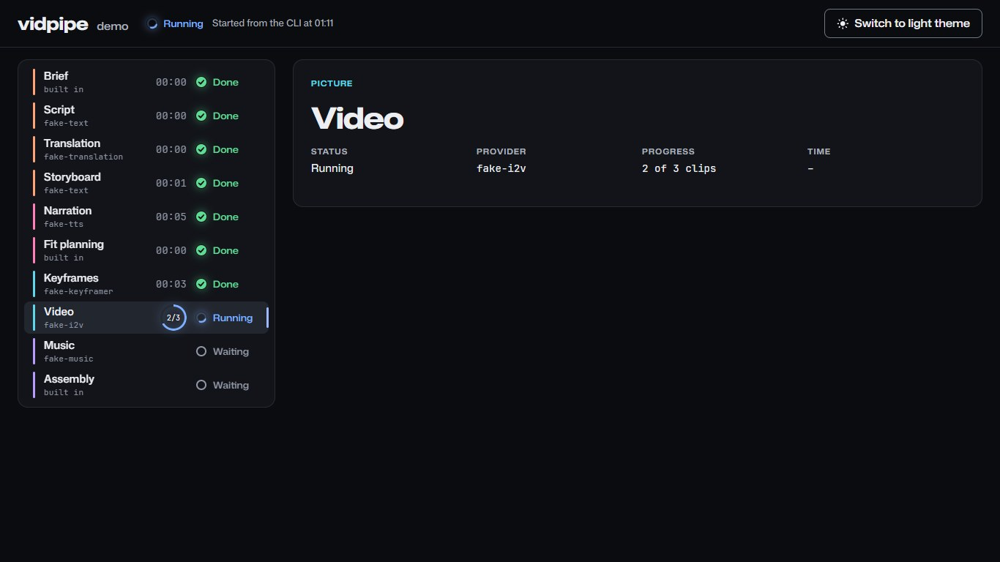

# vidpipe

A provider-pluggable studio pipeline for short video. See `.scratch/vidpipe/spec.md`.

| Document | What is in it |
|---|---|
| [DESIGN.md](DESIGN.md) | the submitted film: audience, shot reasons, visual rules, user tests |
| [ARCHITECTURE.md](ARCHITECTURE.md) | stages, contracts, providers, caching, failure handling, UI |
| [EXPERIMENTS.md](EXPERIMENTS.md) | numbered trials: hypothesis, change, result, decision |
| [FAILURES.md](FAILURES.md) | what broke, what we tried, what fixed it |
| [COSTS.md](COSTS.md) | measured time and GPU minutes, list-price equivalent |
| [ETHICS.md](ETHICS.md) | consent record, licences, labelling, private data |
| [docs/setup.md](docs/setup.md) | installing tools and models |

Where the challenge's suggested layout lives here:

| Brief's name | Here |
|---|---|
| `pipeline/` | [`src/vidpipe/stages.py`](src/vidpipe/stages.py) (the ten stages) and [`src/vidpipe/`](src/vidpipe/) |
| `storyboard.json` | `<project>/storyboard.json` |
| `schema/` | [`schema/`](schema/), generated by `vidpipe schema` |
| `runs.jsonl` | `<project>/runs.jsonl` |
| `outputs/` | each project's `build/` (every intermediate) and `out/` (renders) |

<!-- verify after merge: schema/ exists, storyboard.json and runs.jsonl paths, and
whether the film project and its outputs are committed to the repository -->

## What it does

You write a short brief. vidpipe writes the script, translates it, storyboards it,
speaks it, draws one keyframe per shot, animates each keyframe, composes a score, and
cuts everything into one video per language with subtitles, ducked music and an
optional AI end card. Ten stages, each done by a provider you can swap in
`vidpipe.yaml`. Everything is cached by content hash, so a rerun redoes only what
changed.

It made *The Lion's Whisker*, an Ethiopian folk tale narrated in Amharic, as a 75.5 s
film in 16:9 and 9:16.

## One command

```
uv sync
make film
```

<!-- verify after merge: the `make film` target, which project folder it renders, and
that GNU make is available on Windows -->

Without `make`, the same run is one command per project folder:

```
uv run vidpipe run <project> --auto        # every stage, skipping the approval gates
```

A project folder holds `brief.md`, `vidpipe.yaml` and optionally `bible.yaml`. The
film's 16:9 and 9:16 cuts are two projects with the same text and different sizes. Run
the same command again to resume: finished work is reused.

To check a clean clone without a GPU, run the sample, which uses fake providers and
needs only FFmpeg:

```
uv run vidpipe run examples/sample --auto
```

**Reproducing a film.** The text stages call language models, so a run that starts
from a brief writes new text and makes a new film of the same story. To reproduce a
film, keep its `storyboard.json` (and `bible.yaml`) in the project folder: the script,
translation and storyboard then come from that file and no text model is called.
Narration, pictures, motion and music are still generated, from the same prompts and
seeds. <!-- verify after merge: storyboard.json -->

Other commands:

| Command | Does |
|---|---|
| `uv run vidpipe plan <project>` | shows shots, clips and estimated GPU time; generates nothing |
| `uv run vidpipe doctor <project>` | checks tools, models and fonts |
| `uv run vidpipe redo shot 7 <project>` | redraws and re-animates one shot |
| `uv run vidpipe ui <project>` | web console |
| `uv run vidpipe schema` | writes JSON Schemas for `storyboard.json` and `vidpipe.yaml` into `schema/` |
| `uv run vidpipe export-storyboard <project>` | writes `<project>/storyboard.json`, the editable contract, from a build that has reached the storyboard stage |
| `uv run vidpipe radio-cut <project>` | narration over black, for a first audience test; needs a run through `fit-planning` |

<!-- verify after merge: schema, export-storyboard, radio-cut -->

Each run appends one line per model call to `<project>/runs.jsonl`. In `vidpipe.yaml`,
`subtitles.text_language: en` puts English subtitles on the Amharic render,
`mix.loudness_lufs` sets the loudness of the final mix (default -14 LUFS), and
`music: {candidates: 3, choice: 2}` generates several scores and uses the chosen one.
<!-- verify after merge: runs.jsonl, subtitles.text_language, mix.loudness_lufs,
music.candidates, music.choice -->

## What you need

| Need | Detail |
|---|---|
| NVIDIA GPU | 8 GB VRAM. Tested only on an RTX 4060 Laptop with 31 GB RAM, Windows 11 |
| ComfyUI 0.46.3 | running separately at `127.0.0.1:8188`, with ComfyUI-GGUF at the pinned commit |
| Model files | about 34 GB: FLUX.2 klein 4B, Wan 2.2 TI2V 5B, ACE-Step 1.5 and their encoders ([list](docs/setup.md#comfyui)) |
| FFmpeg | `ffmpeg` and `ffprobe` with libass, `sidechaincompress` and `libx264` |
| A text CLI, signed in | Claude Code or Codex CLI (paid subscription), to write a new film. Not needed when the project has a `storyboard.json` <!-- verify after merge --> |
| Internet | for the text CLI and Edge TTS narration |
| Python 3.12+ and `uv` | |

## What it costs

| | Per format | Both formats |
|---|---|---|
| GPU time, *The Lion's Whisker* | 47.8 min (16:9), 43.6 min (9:16) | 91.4 min |
| Paid per call | $0 | $0 |
| Needs | your own GPU and an existing Claude or Codex subscription | |
| Hosted media APIs at list price (estimate) | about $2.70 | about $5.30, plus text |

About 95% of the GPU time is video: one 5 s clip at 640x352 takes about 3 minutes.
Sources and assumptions are in [COSTS.md](COSTS.md).

## Our stack vs the brief's suggested stack

We did not run the suggested stack, so what follows about it comes from the brief and
public pricing pages, not from our measurements.

| Stage | Brief suggests | We use | What we gain | What it costs us |
|---|---|---|---|---|
| Coding agent | Antigravity CLI or OpenCode, free | Claude Code and Codex | tools we already pay for | not zero cost; their quotas stopped work twice |
| Script, storyboard, translation | Gemini API free tier | Claude and Codex CLIs, with a Gemini CLI adapter | strong models on an existing subscription, schema-checked replies, fallback chains | not free; quota limits; no token counts; vendor terms on automated use unconfirmed. We have not measured quality against Gemini |
| Narration | Gemini 3.8 Flash TTS | Edge TTS; Addis Voices 2 as an option | no API key, free, two Amharic voices | fewer voices and no style instruction; unofficial library; reuse licence unclear |
| Keyframes | Cloudflare Workers AI | FLUX.2 klein 4B on local ComfyUI | no daily allowance, fixed seeds, reference pictures, about 4 to 9 s each | own GPU needed; VAE file carries a non-commercial tag |
| Moving shots | Kaggle T4 notebooks | Wan 2.2 TI2V 5B (GGUF) on local ComfyUI | no weekly quota, queue or session timeout; reruns are immediate | 8 GB limits us to 640x352, upscaled to 720p; one laptop does one job at a time |
| Music | ACE-Step on Kaggle or Colab | ACE-Step 1.5 on local ComfyUI | about 25 s per score | same own-GPU requirement |
| Assembly | FFmpeg, Remotion optional | FFmpeg only | one deterministic filter graph | plain titles and end card |
| Showcase | Hugging Face Space or static page | none; a local web UI instead | control of runs and review | nothing hosted to visit |

**The main trade-off is reproducibility.** Running locally removes quotas and queues,
which is what let us re-roll keyframes freely. It also means a stranger cloning this
repository needs an 8 GB NVIDIA GPU, about 34 GB of models and a running ComfyUI, plus
a paid CLI login to write a new film. Free hosted APIs would be far easier to
reproduce. The provider contracts are the way back: a hosted adapter can replace any
stage without changing the others.

## Try it step by step

```
uv sync
uv run vidpipe plan examples/sample          # resolve providers, fit plan and GPU/cost estimate; generates nothing
uv run vidpipe run examples/sample --until music   # everything except the ffmpeg render
uv run vidpipe doctor examples/sample        # check the dependencies for this project
uv run vidpipe run examples/sample            # full render (needs ffmpeg + ffprobe)
```

A project is a directory with `brief.md`, `vidpipe.yaml` and optionally `bible.yaml` (the
[project bible](#the-project-bible)); artifacts go to `build/`, renders to `out/`. The sample project
uses fake providers only; see [keyframes on ComfyUI](#keyframes-on-comfyui) to draw real ones.

## Artifacts, skip-unchanged and resume

Every generated artifact is recorded in `build/ledger.json` (key, input hash, provider and options,
parameters, seed, GPU seconds, wall time, output file hashes, any recorded fallback). `vidpipe run`
hashes what each artifact depends on and regenerates it only when that changed, so the same command
skips finished work and resumes a run that was killed (the ledger is saved after every artifact).

- Inputs are hashed by *content*: upstream files, plain values (prompts, text), the provider's
  `fingerprint()` and the options configured for it in `vidpipe.yaml`, parameters and seed. A regenerated upstream file that comes out
  identical invalidates nothing downstream.
- Hand edits work: edit `build/script.json` (or a translation) and only the artifacts that read it are
  redone. An artifact whose own inputs are unchanged is never overwritten.
- A stage declares its inputs where it produces an artifact:
  `ctx.produce(key, inputs=Inputs(files=[...], values={...}), parameters={...}, seed=..., make=fn)`
  (`vidpipe.artifacts`). Keys are `<stage>` or `<stage>/<unit>`, e.g. `narration/en/shot_03`.
  `ArtifactStore.forget(key_prefix)` drops records so the next run regenerates them (re-roll).
- `vidpipe run` prints `skipped` or `ran (n generated)` per stage.

## One run at a time

A project has at most one run in progress. `vidpipe run`, `redo` and `approve` hold an OS file lock
on `build/run.lock` (`vidpipe.lock`, through `filelock`) for their whole duration. A second one on
the same project exits with code 1 and `a run is in progress (started from the CLI at 2026-11-26
14:03, process 1234)` instead of writing; who and since when come from the run state below. The OS
releases the lock when the process ends, however it ends, so a killed or crashed run never blocks
the next one; the file left in `build/` means nothing on its own. In the library a refused command
raises `vidpipe.lock.RunInProgress` (a `ProjectError`; its `.holder` is that description).

Projects on network drives (SMB/NFS shares, mapped drives) are unsupported: their file locks are not
reliable, so two runs could both get in. Keep projects on a local disk.

## Run state

While a run (`vidpipe run`, `vidpipe redo`) is in progress it publishes its run state in
`build/run_state.json` (`vidpipe.runstate`), so anything outside the run (the lock refusal above,
the UI) can see which stage is running and how far through it is. The file is replaced atomically
(written to a temporary file, then renamed over it), so a reader never sees half a record. It is
rewritten when the run starts, when a stage begins, after each artifact (at most every 0.25 s, so
reused artifacts do not hammer the disk) and when a stage or the run ends. It stays behind after the
run as the record of how the last run ended. `manifest.json` is unchanged.

```json
{
  "schema_version": 1,
  "run_id": "20261126T140312-3fa9c1",
  "command": "run",
  "shot": null,
  "origin": "cli",
  "pid": 1234,
  "started_at": "2026-11-26T14:03:12+03:00",
  "updated_at": "2026-11-26T14:20:41+03:00",
  "finished_at": null,
  "seq": 42,
  "status": "running",
  "until": null,
  "current_stage": "video",
  "paused_at": null,
  "config_hash": "9b1c...e4",
  "stages": [
    {"stage": "brief", "provider": null, "status": "reused", "done": 1, "total": 1,
     "generated": 0, "reused": 1, "started_at": "...", "finished_at": "..."},
    {"stage": "video", "provider": "fake-i2v", "status": "running", "done": 4, "total": 11,
     "generated": 3, "reused": 1, "started_at": "...", "finished_at": null}
  ],
  "error": null
}
```

- `origin`: `cli`, or `ui` when the environment variable `VIDPIPE_RUN_ORIGIN=ui` is set (the UI
  sets it on the runs it starts; any other value is refused). `command` is `run` or `redo` (then
  `shot` is the re-rolled shot). Times are ISO 8601 local time with the UTC offset.
- `status` (the run): `running`, `stopping` (a stop was asked for), `paused` (at the gate in
  `paused_at`), `failed`, `finished`, `stopped`. `current_stage` is the stage running now, `null`
  before the first stage and after the run ends.
- `stages`: the stages this run covers (up to `until`), in run order. A stage's `status` is
  `waiting`, `running`, `done` (generated something), `reused` (every artifact came from an earlier
  run), `paused` (finished, and its gate holds the run), `failed` or `stopped`. `done` counts the
  artifacts finished so far (`generated + reused`) out of `total`. `total` is worked out from what
  is on disk before the stage starts (shots from the storyboard, clips from the fit plan), so it is
  known up front on a resumed run and is filled in for later stages as earlier ones finish; it is
  `null` while it cannot be known yet.
- `error`: `{"stage", "message"}` when the run failed; `stage` is `null` for a run refused at plan
  time (nothing generated).
- `config_hash`: `vidpipe.runstate.config_hash(project_dir)` of the project config the run started
  with. It hashes the validated config, so comments do not count. A different hash for the config on
  disk means a pending change ([ADR 0002](docs/adr/0002-config-changes-apply-next-run.md)).
- `seq` goes up by one on every write: a reader polling the file can tell a new record from one it
  has seen.

Read it with `vidpipe.runstate.read_run_state(project_dir)`, which retries the brief access denial
a rename can cause on Windows. A record still saying `running` or `stopping` whose process is gone
(killed, crashed) comes back as `failed` with an error saying so, and the stage it was in as `failed`;
the file is left as it is.

## The UI

`vidpipe ui <project>` serves a web console for one project (the optional `ui` extra:
`pip install 'vidpipe[ui]'` or `uv sync --extra ui`; the dev environment has it). The Run view
shows the ten stages as a rail with each stage's status, provider, time and, while it runs, a
progress ring, following the run state live.

The Config view lets you edit the project config, preview the YAML and estimate what the next run
will regenerate. **Save changes** writes the preview while keeping comments and key order.
Each stage offers the providers that implement its contract, with readiness and suggested fixes
from `vidpipe doctor`. The CLI checks cover executable discovery. Text stages also let you
edit their fallback order. Validation runs as you type.

A save during a run is marked pending. The active run keeps the config it started with. Select
**Stop and restart** to finish the current artifact and launch a run with the saved config,
reusing finished work where its inputs still match. Keep the page open until that run starts.

```
uv run vidpipe ui examples/sample                   # http://127.0.0.1:8765/, this machine only
uv run vidpipe ui examples/sample --host 0.0.0.0    # open to the network: prints a link with a token
```



- **Run controls.** Choose **All stages** or a stage to run through, then select **Start run**.
  **Stop** lets the artifact in progress finish. While the run is stopping, **Stop now** cancels
  the current ComfyUI job. **Resume** starts a new run with the previous stage limit selected
  and reuses finished work. The same stop controls apply to a run started from the CLI.
- **Leaving the UI.** Closing the tab leaves the run going. Ctrl+C in the UI server's terminal
  prompts when a run is in progress. Press Enter to leave it running or enter `s` to request a
  graceful stop. A server with redirected input leaves the run going. Reopening the UI picks up
  the project's current run state.
- **Run log.** Expand **Logs and diagnostics** to see the recent output of the current UI-started run.
  Full logs are saved under `build/logs/ui-run-<run-id>.log`. For CLI-started runs, output
  is in the terminal that started them.
- **Access.** By default the UI listens on 127.0.0.1 and accepts only loopback host names (so a web
  page cannot reach it by rebinding a domain to 127.0.0.1). With any other `--host` it requires a
  random token printed at startup as a link, `http://<address>:8765/?token=<token>`: opening it
  swaps the token for an `HttpOnly`, `SameSite=Lax` cookie that the page and its event stream carry;
  scripts can send `Authorization: Bearer <token>`. Anything else gets 401. Use `--port` to move it.
- **HTTP API.** `GET /api/project` (the stages with provider, phase and gate, the project config's
  languages and gates, and the run state), `GET /api/run` (the run state above, or `null`),
  `GET /api/logs` (the log path, recent lines and truncation status), and `GET /api/events`, one
  SSE stream whose `run` events carry the run state on connect and whenever it changes.
  Actions are `POST /api/run/start` (optional JSON `until`), `POST /api/run/stop` and
  `POST /api/run/stop-now` (optional JSON `run_id` to target the run shown on screen).
- **Front end.** No-build HTML, CSS and JS in `src/vidpipe/ui/static/`, styled only with the design
  system there (`style.html` shows every token and component). The rail is operable by keyboard
  (arrow keys, Home, End) and becomes a horizontal strip on narrow screens; a polite live region
  announces only stage start, finish, pause at a gate and failure.

## Stop and stop now

```
uv run vidpipe stop examples/sample          # end the run after the artifact in progress
uv run vidpipe stop examples/sample --now    # cancel the ComfyUI job in progress and end the run
```

A **stop** lets the artifact in progress finish (and be recorded), then ends the run: nothing
finished is lost. **Stop now** also cancels the ComfyUI job in progress (taken out of ComfyUI's
queue, or interrupted if running; only that job) and discards that one artifact; it is not a failure,
so the job is not retried. A provider with nothing to cancel (a text CLI, fakes, Edge TTS) finishes
its artifact, as for a stop. `--now` after a plain stop turns it into a stop now.

Either way the run state shows `stopping` as soon as the run has seen the request, then `stopped`
(the stage in progress `stopped`, with the artifacts it finished in `done`), and `vidpipe run` exits
with code **4**. Resuming is an ordinary `vidpipe run`: everything finished before the stop is
reused.

`vidpipe stop` does not take the project lock (the run holds it). It writes a request,
`build/stop_request.json`, naming the run's `run_id`; the run looks for it every 0.1 s, acts on it
between artifacts (and while it waits for a ComfyUI job, for stop now) and removes it when it ends.
Only the run writes the run state. With no run in progress `vidpipe stop` exits with code 1. In the
library: `vidpipe.stop.request_stop(project_dir, now=False)` (raises `vidpipe.stop.NoRunInProgress`,
a `ProjectError`), and `pipeline.run(...).stopped` is true for a stopped run.

## Gates, --auto and redo

The run pauses for approval after `script`, `storyboard` and `keyframes`. Change the set in
`vidpipe.yaml` (`gates: [storyboard]`, or `gates: []` for none; any stage name is valid).

- A pause is a normal outcome, not an error: `vidpipe run` prints the stages that ran and how to
  continue, and exits with code **3** (`0` = finished, `1` = error, `4` = [stopped](#stop-and-stop-now)). In the library,
  `pipeline.run(...).paused_at` is the gate name.
- Approve with `vidpipe approve <project> <gate>` (no input needed: scripts and tests use this) and run
  again; or `vidpipe run --approve <gate>` (repeatable) to approve in advance; or answer the y/N
  question that appears when stdin and stdout are a terminal. `--auto` skips every gate.
- An approval (`build/approvals.json`) is bound to the *content* of the gated stage's output files. A
  hand edit, a regenerated stage or a `redo` that changes them asks again. A gate after the last stage
  of a `--until` run holds nothing back, so it does not pause.
- `vidpipe redo shot N [project]` re-rolls one shot: its keyframe and video get a new seed (the
  per-shot re-roll count is `rerolls` in `build/ledger.json`, the seed is recorded in each artifact),
  and the assemblies that use it are redone. Other shots, narration and music are untouched. Gates
  apply, so the new keyframe is shown at the keyframes gate before it is animated; `--auto` and
  `--approve` work as for `run`.

## Fit planning and `vidpipe plan`

Narration comes first, so its real length decides how much video is generated. For each shot the
fit planner (`vidpipe.fit`) writes `build/fit_plan.json`:

1. **One clip, speed first.** A clip is played at a speed between 1/1.3 and 1.3 so the shot lasts
   exactly as long as its narration (`speed` is a playback rate on the *video*: `0.88` is slower,
   so a 5.66 s line fits a 5 s clip; narration is never time-stretched). A clip that is clearly too
   long is sped up (up to 1.3x) and trimmed.
2. **Then continuation clips.** If one clip cannot cover the narration, it is cut into segments at
   natural boundaries (`vidpipe.segmentation`): sentence ends first, then clause marks (`, ; :`,
   Ethiopic `። ፣ ፤`), then a pause between words, each only where the coarser cut cannot make the
   pieces fit; fewest clips first, then the most natural cuts. Each segment is one clip; every clip
   after the first is a *continuation clip*. FFmpeg extracts the previous clip's last frame, and
   the video provider uses it with a prompt to continue the shot's motion and cover the next
   narration segment. Each clip is saved separately so a resumed run can reuse completed clips.
3. **`visuals`** in `vidpipe.yaml`: `shared` (default: one clip set per shot, sized to the longer
   narration; the shorter language plays it slightly faster or trimmed), `per_language` (a clip set
   per language) or `primary_only` (the primary language's clips; another language that needs more
   than 1.3x slow-down is an error). Every render must stay within 90 s, else fit-planning fails and
   names the language.

`vidpipe plan PROJECT [--until STAGE] [--json]` is the dry run: it prints each shot's clips,
segments (with their time in the render), speed factors and continuation clips, and the estimated
GPU minutes (local providers) or dollars (hosted) per stage and overall. It calls no provider's
generation method and writes nothing. It needs a storyboard to know the shots
(`vidpipe run PROJECT --until storyboard`); narration durations are the real ones when narration
was generated for the current text, otherwise estimated from the script at the TTS provider's
declared `seconds_per_char` (marked `estimated`). The stage totals are for a run from scratch.
The regeneration estimate uses the current ledger and matches the Config view. It marks downstream
stages as possible regeneration when their inputs depend on work that has yet to run.

Providers declare what their work costs as a `cost = CostModel(...)` class attribute: GPU minutes
(`gpu_minutes`, for providers with `uses_gpu = True`) or `dollars` (hosted), per `CALL` or per
`OUTPUT_SECOND`. The default is free. Conformance checks the declaration is consistent.

`fit_plan.json` per shot: `visual_sets` (`shared`, or one per language) each with `clips`
(`index`, `seconds` to generate, `continues` = index of the clip whose last frame it starts from,
`text` it covers) and `languages[lang]` with `visual_set`, `seconds` (shot length in that render =
narration length), `clips` (how that render plays each clip: `speed`, `source_s` used, `seconds`
shown) and `segments` (`text`, `start_s`/`end_s` in the render, `clip`: subtitle cues).
`render_seconds` has each language's total.

## The project bible

`bible.yaml` says who and where the story is about, and how it looks. Everything in it is optional.

```yaml
style:
  description: "Photorealistic live-action documentary footage, soft morning light."
  reference: bible/style.png             # optional
characters:                              # the first one is the protagonist
  - id: aster
    name: Aster                          # how the prompt calls them (default: the id)
    description: "A ten-year-old girl: two black braids, indigo dress, yellow shawl."
    reference: bible/aster.png           # path relative to the project folder
locations:
  - id: village
    name: the highland village
    description: "Round stone houses with thatched roofs on green terraced slopes."
```

- Each entry needs a `description`, a `reference` picture (`.png`, `.jpg`, `.webp`), or both. Ids
  are lowercase letters, digits, `-` and `_`. Write descriptions in English.
- **Casting.** The storyboard stage tells its text provider the ids and names, and each shot gets
  `character` and `location` in `build/storyboard.json`. A shot with no `character` shows the
  protagonist; `"none"` means nobody (use it for object and scenery shots, or the model may draw the
  protagonist into them); no `location` means none. Hand-edit the storyboard to recast a shot.
  Adding, removing or renaming entries re-runs the storyboard (overwriting hand edits); rewording
  or replacing a picture redraws only the keyframes that use it.
- **What a keyframe receives** (`vidpipe.bible.keyframe_brief`): the pictures of the shot's
  character, then its location, then the style, as many as the keyframer accepts (two for the default
  model). The prompt is the shot's `visual` plus a sentence per entry: "image N" for an entry whose
  picture was passed, its description otherwise. A keyframer that takes no pictures gets
  descriptions only, so give every entry one. The style description is always included.
- **The default look is live-action.** Without a `style`, the storyboard and every keyframe are
  asked for photorealistic live-action footage (`vidpipe.bible.DEFAULT_LOOK`), because the video
  model animates real-looking footage far better than illustration. A `style` replaces it. Keep
  the style to the look (lighting, lens, texture): anything it describes appears in every shot.
- Each keyframe's ledger record lists the prompt, the pictures (with content hashes), the seed and
  the settings it was drawn with.

**Making reference pictures.** Supply them as files; the pipeline does not generate them. A character
sheet or an empty view of a place can be drawn with the keyframer itself, about 10 s each (run this
in the project folder):

```python
from pathlib import Path

from vidpipe.contracts import KeyframeRequest
from vidpipe.providers.comfy_keyframer import ComfyKeyframer

keyframer = ComfyKeyframer()
keyframer.generate(
    KeyframeRequest(
        prompt="Character reference sheet of one girl ... front view, side view and face, plain "
        "light background. Photorealistic studio photograph.",
        width=1280,
        height=720,
        seed=1,
        output_path=Path("bible/aster.png"),
    )
)
keyframer.release()  # free ComfyUI's memory
```

There is no negative prompt: describe what should be in the picture. The sample project ships a
placeholder protagonist (`examples/sample/bible/protagonist.jpg`) made this way.

## Keyframes on ComfyUI

`comfyui-keyframer` draws each shot with FLUX.2 [klein] 4B on a running ComfyUI
([ADR 0001](docs/adr/0001-keyframe-model.md)). vidpipe does not install or manage ComfyUI.

| Needed | Pinned |
|---|---|
| ComfyUI | 0.46.3 |
| Custom nodes | none |
| `diffusion_models/` | `flux-2-klein-4b-fp8.safetensors` |
| `text_encoders/` | `qwen_3_4b.safetensors` |
| `vae/` | `flux2-vae.safetensors` |

```yaml
width: 832          # multiples of 16, 256-1280 a side, at most 921600 pixels (1280x720)
height: 480
comfyui:
  url: http://127.0.0.1:8188     # the default
providers:
  keyframes: comfyui-keyframer
  # keyframes:
  #   name: comfyui-keyframer
  #   options: {settings: {reference_megapixels: 0.25}, retries: 2, timeout_s: 600}
```

- Options: `workflow` (a bundled model's name or a mapping file in the project), `settings` (the
  mapping's fields: `reference_megapixels` 0.5, `steps`), `url` (overrides `comfyui.url`), `retries`,
  `timeout_s`, `poll_s`. Changing `workflow` content or `settings` redraws; `url`, `retries`,
  `timeout_s` and `poll_s` do not.
- Jobs run one at a time. After the stage (also a failed one) ComfyUI is asked to unload its models.
- **Failures.** A job that errors, times out, disappears or saves nothing is retried up to twice with
  new seeds. After an out-of-memory error, memory is freed and one step-down from the mapping is
  applied (reference size 0.5 → 0.25 MP; without references, the next smaller size), with a new seed;
  running out of memory again fails the stage. A rejected workflow (missing model), an unreachable
  server or a job cancelled in ComfyUI fails at once. Finished shots are kept, so the next run
  resumes after them. Ctrl+C removes the running job from ComfyUI's queue.
- The artifact record says what happened: `fallback` (retries and step-down in words),
  `data.seed` (the seed that drew it), `data.attempts`, `data.settings`, `gpu_seconds`.
- On an RTX 4060 Laptop 8 GB an 832x480 keyframe takes about 4.5 s without a reference, 6.5 s with
  one and 9-12 s with two; `plan` assumes 0.11 GPU minutes each.
- Look at the keyframes at the gate: the model sometimes draws a character twice or drifts in small
  details. `vidpipe redo shot N` draws that shot again with a new seed.

Samples from real runs: [the sample project](docs/assets/keyframes-sample-project.jpg) (left: the
reference character in a place described in words; middle: `character: none`; right: a cup of coffee
that also received the protagonist's picture by default, which the model left out) and
[a two-reference run](docs/assets/keyframes-two-references.jpg) (top: the protagonist and location
pictures and a shot drawn from both; bottom: a shot before and after `redo`, and a two-reference
shot showing the duplicated-character defect).

## Music on ComfyUI

Set `providers.music` in `vidpipe.yaml` to generate an instrumental score with ACE-Step 1.5 Turbo.
The bundled workflow uses ComfyUI 0.46.3 core nodes and
`models/checkpoints/ace_step_1.5_turbo_aio.safetensors`. The project configuration selects the
provider and can override its tempo and key.

```yaml
providers:
  music:
    name: comfyui-music
    options:
      settings: {bpm: 90, keyscale: E minor}
```

`vidpipe run PROJECT --until music` writes `build/music/music.flac` and indexes it in
`build/music.json`. The soundtrack covers the longest language render, rounded up to a whole
second. Assembly trims the same score to each render and ducks it under the narration. The ledger
records the measured duration, ComfyUI execution time and any retry. On out-of-memory, the
bundled workflow retries with smaller decode tiles and the requested duration intact.

For a hosted ComfyUI instance with the same checkpoint, set `options.url` on the music provider to
the instance's address. This is a manual switch. To use another music backend, register a
`MusicProvider` and select it by name in the same YAML field. The sample selects `fake-music`
for GPU-free runs.

The separate `SongProvider.sing(SongRequest(...))` contract takes lyrics and a vocal language and
returns a mixed audio file. `fake-song` returns a deterministic WAV tone for conformance tests.
The project stage graph uses the instrumental music contract for assembly.

## Image-to-video on ComfyUI

Set `providers.video` to `comfyui-i2v` to animate each keyframe with Wan 2.2 TI2V 5B
Q5_K_M. The provider uses the fit plan's duration and the storyboard's motion
(`pan`, `push_in`, or `ambient`). It saves H.264 MP4 clips at 24 fps, rounded up
to the next whole frame, with a default size of 640x352. Set `VIDPIPE_FFMPEG_DIR` or put `ffprobe` on PATH
so vidpipe can verify each clip's duration before recording the artifact.

| Needed | Pinned |
|---|---|
| ComfyUI | 0.46.3 |
| ComfyUI-GGUF | `6ea2651e7df66d7585f6ffee804b20e92fb38b8a`, gguf 0.19.0 |
| `unet/` | `Wan2.2-TI2V-5B-Q5_K_M.gguf` |
| `text_encoders/` | `umt5_xxl_fp8_e4m3fn_scaled.safetensors` |
| `vae/` | `wan2.2_vae.safetensors` |

```yaml
providers:
  video: comfyui-i2v
  # For a larger output:
  # video: {name: comfyui-i2v, options: {settings: {width: 832, height: 480}}}
```

The video size is set by the workflow, independently of the keyframe and
assembly dimensions. Either orientation is accepted within the pixels of 832x480,
so a portrait 352x640 works for vertical video (see `output_size` under Assembly).
Jobs run sequentially. If ComfyUI runs out of memory at the default size, the
workflow retries once at 512x288 (288x512 for a portrait frame) and keeps the
planned duration. The ledger records each clip's measured duration and ComfyUI
execution time, including failed attempts that preceded success. At 640x352
on an RTX 4060 Laptop GPU with 8 GB VRAM, the three-shot run took about 37
seconds of ComfyUI execution per second of video.

With the models installed and ComfyUI idle, run the video integration tests
with `uv run pytest -m integration -k "comfyui-i2v or wan_animates"`. The
pipeline test also uses the FLUX keyframe models listed above.

## Adding a ComfyUI model or provider

**Another model for an existing provider needs no Python:** export the workflow in API format, write
a mapping file next to it ([format](workflows/README.md#mapping-files)), and select it:

```yaml
providers:
  keyframes: {name: comfyui-keyframer, options: {workflow: workflows/my_model.mapping.yaml}}
```

`vidpipe plan` checks that every mapped node input exists, and takes capabilities and cost from the
mapping. A workflow shipped with vidpipe goes in `workflows/` and is selected by name.

**A new workflow-backed contract** needs a small provider class on
`vidpipe.comfy.provider.ComfyProvider`, which supplies options, URL handling, fingerprinting,
uploads, retries, the step-down, cancellation and memory release:

1. Subclass `ComfyProvider[<Capabilities>]` and the contract class; set `name`, `default_workflow`
   and `required_fields` (values every workflow variant must accept).
2. `declare_capabilities(model)`: usually `Capabilities.model_validate(model.spec.capabilities)`.
3. In the contract method: refuse what the capabilities do not allow (`UnsupportedRequest`), call
   `self.run_workflow(values, seed=..., images=[...], extras=request.extras)`, then
   `self.save_output(outcome, request.output_path)`, and return the result with
   `record=self.record(outcome, images=len(images))` (add a `record: GenerationRecord` field to the
   result model if it has none).
4. In the stage, call the provider through `_generate(...)` and return `_recorded(path,
   result.record, seed=seed)` (`vidpipe.stages`), so retries and GPU time reach the ledger.
5. Register it and give it a conformance test against the fake server (`tests/fake_comfyui.py`; add
   a writer to `WRITERS` for a new output node).

## Assembly, ducking and subtitles

`vidpipe run` ends with the assembly stage: for each language it writes `out/<output_name>_<lang>.mp4`
(`demo_en.mp4`, `demo_am.mp4`) and the sidecar `out/<output_name>_<lang>.srt`, and each render stays
within the 90 s limit (fit-planning refuses longer plans, and assembly checks again).

- **Video.** The clips of each shot play back to back at the speeds in `fit_plan.json`
  (`languages[lang].clips`: `speed`, `source_s`, `seconds`). Assembly joins continuation clips
  directly and adjusts the end of the shot to match its narration.
- **Audio.** The shots' narration is joined, and the music sits under it at `mix.music_level` and is
  pushed down by a sidechain compressor keyed on the narration (`mix.duck_ratio`; threshold -30 dB,
  attack 20 ms, release 400 ms), so the music drops while someone speaks and swells back in the gaps.
- **Subtitles.** One cue per fit-plan segment (`segments[].text/start_s/end_s`, offset to the shot's
  place in the render). The SRT is written whether or not it is burned in; `subtitles.burn_in: false`
  keeps only the sidecar. Burning uses ffmpeg's `subtitles` filter (libass) with the fonts folder given
  as `fontsdir`; the filter text escapes Windows drive colons and any `' [ ] , ;` in paths
  (`vidpipe.subtitles.escape_filter_value`).

```yaml
subtitles:
  burn_in: true
  fonts_dir: fonts                   # relative to the project dir (or absolute). Default: ./fonts if
                                     # it exists, else the fonts bundled with vidpipe (assets/fonts)
  fonts: {am: Noto Sans Ethiopic}    # font family per language; others use the system default font
  font_size: 20                      # libass units: the video's height is 288, so it scales with it
mix:
  music_level: 0.4
  duck_ratio: 8
```

**Aspect ratio (`output_size`).** The video model draws at its own size (640x352 by default, a
multiple of 32 on each side, so not exactly 16:9). `output_size` renders the final videos at another
frame: each clip is scaled to cover it and cropped to its shape, so 640x352 becomes exact 16:9 with a
2% side crop. For vertical video, generate in portrait and render at 9:16; the Wan workflow accepts
either orientation within the pixels of 832x480. Changing `output_size` re-runs only assembly.

```yaml
# 16:9                                   # 9:16
width: 640                               # width: 352
height: 352                              # height: 640
output_size: {width: 1280, height: 720}  # output_size: {width: 720, height: 1280}
providers:
  video: {name: comfyui-i2v, options: {settings: {width: 640, height: 352}}}  # 352x640 for 9:16
```

**AI disclosure end card (`end_card`).** Off unless set. It adds a card on black after the last
shot: a headline and smaller lines saying the video is AI-generated and that any resemblance to
real people or voices is coincidental. Default wording is built in for English and Amharic (the
Amharic card repeats "AI-generated video" in English). Other languages get the English wording
unless `text` gives their own; the first line is the headline. The music is generated long enough
to play under the card and fades out over its last 3 s, and the 90 s limit includes the card.

```yaml
end_card:
  seconds: 5                         # up to 15
  text: {en: "Made with AI\nAny resemblance to real people is coincidental."}  # optional
```

**Fonts.** Noto Sans Ethiopic (Regular and Bold, SIL OFL 1.1) is bundled in `assets/fonts/` with its
licence (`OFL.txt`); the licence allows redistributing the unmodified fonts. `vidpipe plan` (and so
`run`) reports a missing fonts folder, or a folder without the font a language needs, before anything
is generated; with `burn_in: false` no font is needed. Add a language by listing its font family
under `subtitles.fonts` and putting the font file in the fonts folder.

**ffmpeg.** Assembly needs `ffmpeg` and `ffprobe` with libass (the `subtitles` filter) and
`sidechaincompress`. Set `VIDPIPE_FFMPEG_DIR` for a portable build or use tools already on `PATH`.
See the [setup guide](docs/setup.md) for provider prerequisites and `vidpipe doctor`. The assembler
interface is `Assembler.problems()` and `Assembler.assemble(AssemblyJob)` (`vidpipe.assembly`). The
job carries the shots per language (`ShotSegment` with narration, length and `ClipPlay` list), the
music, a `SubtitleTrack` and the `MixSettings`.

## Development

- `uv run pytest` runs the fast suite on fake providers. Three seams: the pipeline run through
  the CLI/library (`tests/test_pipeline.py`, `tests/test_resume.py`), the per-contract provider conformance suite
  (`tests/conformance/`), and the UI's HTTP API (`tests/test_ui_run_view.py`, a real server on a free
  port watching CLI runs; skipped without the `ui` extra). ComfyUI providers are tested against an in-process fake server
  (`tests/fake_comfyui.py`, fixture `comfy`); `uv run pytest -m integration -k comfy` runs them on a
  real ComfyUI at 127.0.0.1:8188 with the models above. With the ACE-Step checkpoint installed,
  `uv run pytest -m integration -k 'comfyui_music or comfyui-music'` runs just the music tests,
  including a 90-second score.
- Tests that need real `ffmpeg`/`ffprobe` carry `@pytest.mark.needs_ffmpeg`: they skip cleanly when the
  binaries are absent and run automatically once they are on `PATH`.
- Real-provider tests (ComfyUI, CLIs, edge-tts) carry `@pytest.mark.integration` and only run with
  `uv run pytest -m integration`. A registered provider with `fake = False` is collected into the
  conformance suite with that marker automatically.
- `uv run ruff check . && uv run ruff format --check . && uv run pyright`

### Narration (edge-tts)

`edge-tts` needs network. Configure it per project, with per-language voices:

```yaml
providers:
  narration:
    name: edge-tts
    options:
      voices: {am: am-ET-MekdesNeural}   # defaults: en-US-AriaNeural, am-ET-AmehaNeural
    fallback: [mms-tts]                  # declared only; MMS-TTS is not implemented yet
```

Each narration clip's real length is `duration_s` in `build/narration.json`, read from the MP3.

### Amharic narration with Addis AI

Set `ADDIS_API_KEY` in the process environment and select `addis-ai` for narration.
This sends Amharic lines to Addis Voices 2 and uses Edge TTS for English.

```yaml
providers:
  narration: {name: addis-ai, options: {amharic_voice: am-hamen}}
```

The provider measures the downloaded MP3 so the fit plan uses the actual speech timing.
See the [Addis AI text-to-speech guide](https://docs.addisassistant.com/docs/capabilities/text-to-speech)
for voices and pricing.

### Adding a provider

1. Subclass the contract class for its kind in `vidpipe.contracts` (`TextProvider`,
   `TranslationProvider`, `TTSProvider`, `KeyframerProvider`, `ImageToVideoProvider`,
   `MusicProvider`, `SongProvider`), set `name` and `capabilities`, and implement the one method.
2. Register it with `@register` (`vidpipe.registry`), importing the module from
   `vidpipe/providers/__init__.py`, or expose the class through a `vidpipe.providers` entry point.
3. If it costs GPU time or money, declare `cost = CostModel(...)` (and `uses_gpu = True` for local
   GPU work); a TTS provider also sets `capabilities.seconds_per_char`. Optional hooks:
   `attach(ProjectContext)` (project folder, `comfyui.url`), `release()` (called after the stage),
   `unhashed_options` (options that must not regenerate artifacts). Raise `GenerationError` when an
   asset cannot be made.
4. Select it per stage in `vidpipe.yaml` (`providers: {narration: my-tts}`, or
   `{name: my-tts, options: {...}}` to pass constructor options).
5. It is picked up by `tests/conformance/test_providers.py` automatically and must pass the shared suite.

### Text providers (script, storyboard)

`script` and `storyboard` use CLI text providers: `gemini-cli`, `claude-cli`, `codex-cli` (each also
takes `options: {model:, timeout_s:, command:}`). Each CLI runs non-interactively in an empty
temporary directory with agent tools disabled; its reply is checked against the stage's Pydantic
model and re-prompted with the error up to twice. Check each vendor's current terms for automated
CLI use, and log in to each CLI yourself beforehand (vidpipe never handles credentials).

A stage can list a fallback chain; the next provider is tried on failure, rate limit or exhausted
re-prompts (default for `script` and `storyboard`: Gemini, then Claude):

```yaml
providers:
  script: [gemini-cli, claude-cli]          # or [{name: gemini-cli, options: {model: ...}}, codex-cli]
  storyboard: claude-cli
```

Tests drive the adapters through fake `gemini`/`claude`/`codex` executables on PATH
(`tests/fake_cli.py`, fixture `fake_clis`); `fake-text` keeps the offline pipeline fast. To run the
real CLIs through the conformance suite: `uv run pytest -m integration -k text`. When a chain falls back,
the artifact record in `build/ledger.json` says which provider failed and which answered.

### Translation (English to Amharic) and the back-translation check

`translation` is done by text providers through the same chain as `script` (default: Gemini CLI, then
Claude CLI), or by a registered translation provider such as `fake-translation`:

```yaml
languages: [en, am]          # the first language is the script's; the others are translated
providers:
  translation: [gemini-cli, claude-cli]    # default; `translation: claude-cli` also works
```

The script goes out as numbered lines and comes back as the same lines (ids preserved, so narration
and storyboard shots still line up). A reply that loses, invents or renumbers a line, or leaves a
line without Ge'ez script, is re-prompted. Output: `build/translation/<lang>.json`.

**Back-translation check.** After translating, a model translates the Amharic back to English
*without seeing the source*, then compares that with the source line by line. The result is
`build/translation/<lang>.review.json` (a `TranslationReview`) and the ledger artifact
`translation/<lang>/review`:

```json
{"language": "am", "source_language": "en", "translator": "gemini-cli", "checker": "claude-cli",
 "same_model": false,
 "lines": [{"id": 2, "status": "drift", "source": "...", "translation": "...",
            "back_translation": "...", "reason": "one-sentence reason"}]}
```

- The checker is never the translator when the chain has another provider: it is built from the other
  members only, and the check fails (the translation is kept; the next run resumes at the check) if
  they all fail. A chain with nobody else runs the check with the translator and records
  `"same_model": true`. Members are "the same model" when name and options are equal.
- Drifted lines are flagged `"status": "drift"` with a `reason`. They do not stop the run: `vidpipe run`
  prints each one (with the English, Amharic and back-translation) to stderr (also when the run pauses at a gate, and at the interactive prompt of any gate after `translation`), and the ledger record's
  `data.drifted` lists their ids. `vidpipe.translate.drift_flags(project)` returns them as `DriftFlag`s
  for a gate or report to show.
- The check re-runs if the translated file is hand-edited, so fixing a flagged line clears its flag.
  Translation providers that are not text chains (`fake-translation`) are not back-checked.

**Unicode.** Every file vidpipe writes is UTF-8 (raw Ge'ez, not `\u12xx` escapes) and the CLI text
adapters pipe UTF-8 both ways. A Windows console prints Ge'ez natively (needs a font with Ethiopic
glyphs, e.g. Nirmala UI); *redirected* output used to fall back to cp1252 and crash, so `vidpipe`
now switches stdout/stderr to UTF-8 when they are not already. Windows PowerShell 5.1 decodes piped
native output with `[Console]::OutputEncoding`: set it to UTF-8 if you pipe vidpipe's output there.
